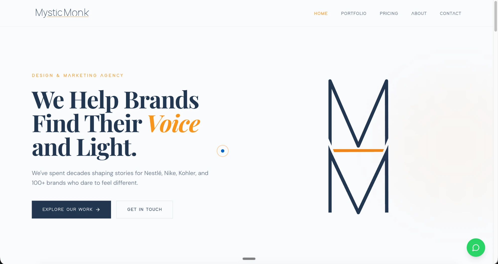
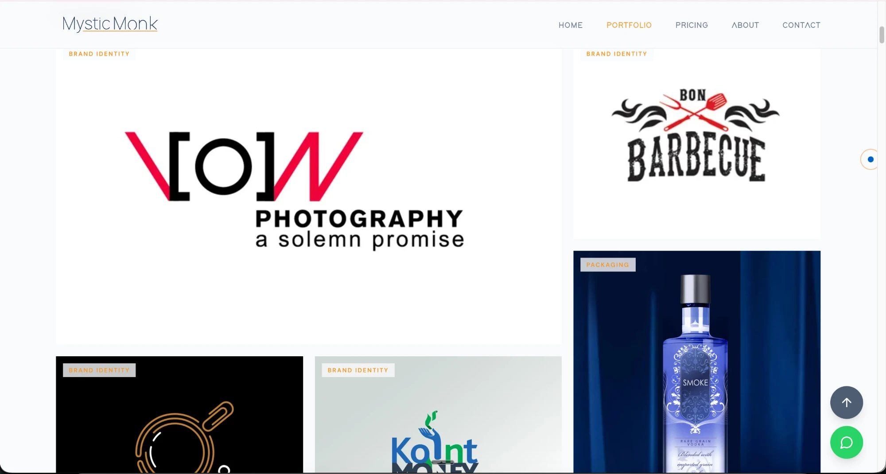
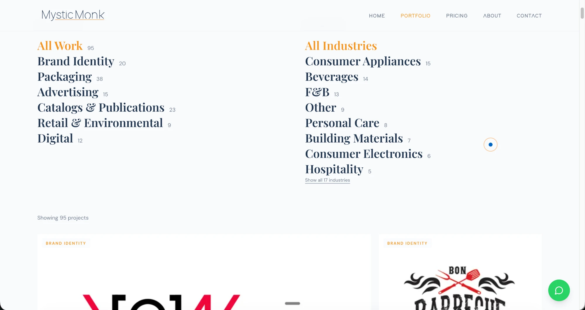
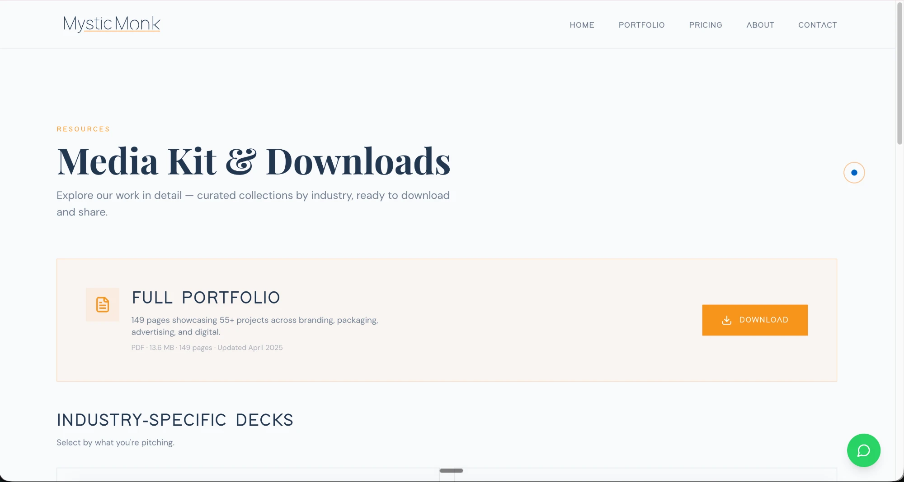

# Mystic Monk: rebuilding an agency website after a malware infection

**Live:** [mysticmonk.xyz](https://mysticmonk.xyz)

A case study of a from-scratch website rebuild for Mystic Monk, a New Delhi advertising and design agency, built with Lovable and Claude Code. The source is private; this is the story and the result.

## Why it was rebuilt

The old site was a WordPress build that had been infected with wp-vcd malware. It kept failing, and clicking some links redirected visitors to spam and adult sites, which for an advertising agency is the website working against you.

The first thing I tried was the cheap fix: revert to a clean default theme and get back to a working baseline. It didn't hold. A code-level analysis showed why. wp-vcd reinfects whatever theme you swap in, so you can't clean a site like this in place. That made the call clear: rebuild off WordPress entirely, onto a static stack with no PHP theme surface to reinfect, and move it off the old shared host.

## The design

Rather than guess at a single look, I built three directions in parallel and put them behind a `/compare` page so the team could judge them side by side:

- **Editorial:** serif typography, warm neutrals, restrained motion
- **Bold:** all-caps sans, high-contrast navy and gold
- **Cinematic:** dark theme, serif and mono, atmospheric gradients

The site that shipped is a considered blend rather than a clean pick: the editorial look leads, a warm, serif-led homepage, it opens with the cinematic intro animation, and it carries the copy we liked best across the directions. Because the code kept each direction isolated, consolidating onto the final look meant deleting the other two, not a rewrite.

## Highlights

- **Custom-coded motion:** a hand-built logo-draw intro and loading animation, plus scroll reveals, written in code rather than pulled from a library, because for an agency the craft is the pitch.
- **Segmented portfolio downloads:** eight industry-specific portfolio PDFs alongside the full 149-page deck, generated from the agency's master deck with a Python pipeline, so a prospect downloads only the work relevant to what they are pitching ([see them](https://mysticmonk.xyz/resources)).
- **Masonry portfolio grid** with four card sizes and cross-filter-aware counts (work-type counts respect the active industry filter, and the reverse), plus a wipe-reveal on scroll.
- **Exit-intent flyout:** catches a visitor as they move to leave and offers one last, relevant nudge.
- **Location-aware pricing:** detects the visitor's country and shows INR, KES, or USD, with a manual override.
- **Performance:** every image converted to WebP through an in-repo script, cutting the portfolio from 93MB to about 10MB, roughly 90 percent smaller.
- **Built for search and for LLMs:** every route prerendered to static HTML at build time, JSON-LD structured data, city landing pages, a sitemap, and an `llms.txt`.
- **India-first contact:** WhatsApp as the primary call to action, with a hardened contact form as the fallback.

## Stack

React 18, TypeScript, Vite, Tailwind CSS, shadcn/ui, Framer Motion, React Router, React Query, and React Hook Form with Zod. Deployed on Cloudflare Pages.

## The migration

Cutting over from the old host to Cloudflare Pages without dropping email took some care. I left the MX records untouched so Google Workspace mail kept flowing, changed only the website records, enabled DKIM, and staged DMARC in monitor mode before tightening it. The full DNS baseline was backed up first.

## Screenshots

The portfolio grid: a masonry layout with cross-filter-aware counts.

Filter by work type and industry, with counts that update against each other.

The media kit: segmented, downloadable portfolio decks by industry.

## Honest status

This is a front-end site: the contact form runs on a third-party service and there is no backend. A few items are still open, including an accessibility pass and a planned move to Astro for near-zero-JS static output. It shipped fast and clean, off the compromised host, which was the point.

## Built with

Lovable for the initial design build, then Claude Code for the ongoing engineering and content. The source repository is private; happy to walk through it on request.
